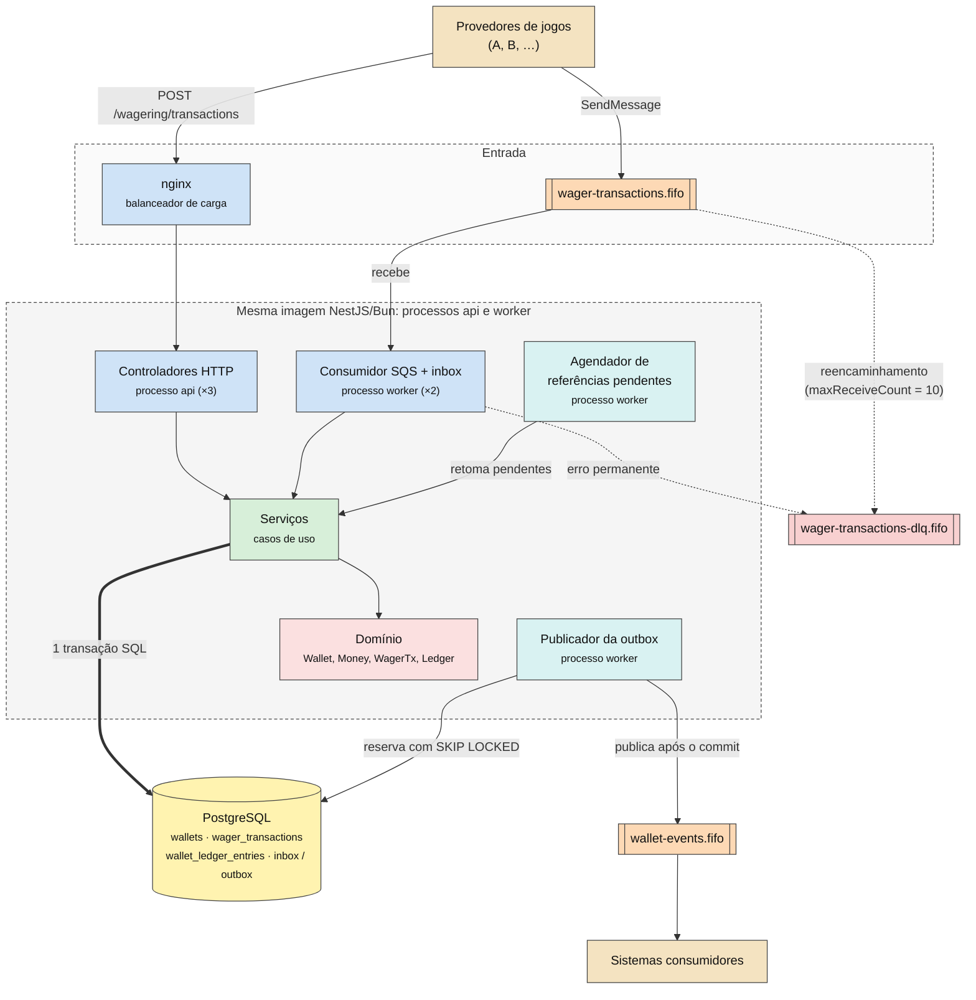

# Arquitetura

Decisões, trade-offs e limitações do Distributed Wagering Processor. O registro completo de cada escolha, com as alternativas, está no [ESCOLHAS.md](ESCOLHAS.md) (citado aqui como #n). Os diagramas estão em [formal_documentation/architecture.pdf](formal_documentation/architecture.pdf), e os contratos e a operação de cada serviço em [project/docs/](project/docs/).

## 1. Visão geral

O diagrama abaixo é a arquitetura de solução: os mesmos componentes e fluxos da figura "Componentes e fluxos principais" do [architecture.pdf](formal_documentation/architecture.pdf), lidos de cima para baixo.

O PostgreSQL é a única fonte de verdade. A fila SQS FIFO, a deduplicação do broker e qualquer cache são otimizações: as garantias vêm de constraints, índices únicos, triggers e transações SQL.

- **Dois processos, um código (#27):** a `api` serve só HTTP atrás do nginx, e o `worker` (sem HTTP) roda o consumer SQS, o publisher da outbox e o reprocessamento de `PENDING_REFERENCE`. As duas entradas chamam os mesmos services, então a regra de negócio existe uma vez só.
- **Camadas:** controller → service → repository → persistence, com o domínio puro no centro (sem NestJS, MikroORM ou Zod). O service é o dono da transação, e o `ErrorHandler` é o único ponto que transforma erro em resposta HTTP ([api.md](project/docs/api.md) §3.1).
- **Schema em SQL (#1):** tabelas, constraints, índices e triggers são migrations do Flyway aplicadas pelo `database-init`, um container de execução única, antes das réplicas subirem. O MikroORM só acessa dados.

## 2. Decisões e trade-offs

| Tema | Escolha | Trade-off aceito |
| --- | --- | --- |
| ORM e schema (#1) | MikroORM para dados; schema em SQL puro com Flyway | Mapeamento e migration escritos à mão, mas toda garantia da §5.9 fica explícita e revisável |
| Concorrência (#4, #5) | Bloqueio otimista por `version`, retry da transação inteira | Wallet muito disputada gera retries; em troca, nenhum lock é segurado na leitura |
| Money (#6, #7) | `numeric(20,2)` + `char(3)`, lido como string; só `BRL` na lista de moedas aceitas | Escala fixa de 2 casas: moedas de 0 ou 3 casas ficam fora |
| Idempotency-Key (#8) | `{providerId}:{externalTransactionId}`; o header é a fonte da verdade | A API não detecta um header incoerente com o body |
| payloadHash (#17) | `"v1:" + sha256(JSON canônico)` dos campos de negócio | Mudar os campos exige `v2:`; os hashes antigos continuam comparáveis |
| Ledger (#10, #18, #26) | Entrada simples; cursor keyset `(created_at, id)` | Sem conta da casa; a auditoria é por wallet |
| Wallet (#12, #22) | `debit`/`credit` devolvem o `WalletLedgerEntry`; saldo insuficiente lança erro de domínio; nomes do enunciado | `debit` precisa receber o id da transação |
| Transições (#13) | `PENDING` só dentro da transação SQL; validadas no domínio | O banco barra só a saída de estado terminal, não as transições intermediárias |
| failureCode (#14) | 13 códigos, um por causa | Código publicado nunca muda: provedores dependem do valor |
| Status HTTP (#16) | Um status por situação; replay devolve o status original | `walletId` inexistente é `404` sem registro, para manter a FK da transação |
| DLQ (#19) | A aplicação decide na 5ª entrega; redrive do SQS em 10 | Mensagens devolvidas por bloqueio do grupo também contam entrega no SQS |
| Referência pendente (#9, #15) | 10 tentativas, backoff 2 s a 300 s, configurável; gatilho imediato | Um `UPDATE` a mais no caminho crítico ao processar uma transação referenciável |
| Outbox (#20, #28) | Backoff com teto e sem limite; bloqueio na transação durante a publicação; fila `wallet-events.fifo` | A transação fica aberta durante a chamada ao SQS |
| Regras não cobertas pelo enunciado (#21) | Rodada como entidade com fechamento; uma reversão por `BET`; `BET` cancelada antes de chegar é rejeitada | Mais estado e mais regras do que o enunciado exige |
| Autenticação (#3, #3a) | Não implementada; `AuthGuard` no-op e `ProviderIdentityPort` como pontos de extensão | Sem demonstração de IAM no emulador; acesso administrativo fora do escopo |
| Observabilidade (#23, #24) | OTLP → collector → Jaeger, Prometheus, Loki; Grafana provisionado | Instrumentação manual: no Bun a automática não funciona |

## 3. Estratégia transacional

Inbox (entrada SQS), transação de aposta, saldo, lançamento do ledger e evento da outbox são gravados na mesma transação SQL (§6.5 e §11).

- O service abre a transação com `runTransaction` ([run-transaction.ts](project/api/src/database/run-transaction.ts)), que envolve `em.transactional()`. Os repositories só fazem `persist`, e o `flush` acontece no commit.
- Rejeição de negócio é resultado persistido, não rollback: a transação `REJECTED` e o evento são gravados, o commit acontece, e só depois o service lança o erro que vira `422`.
- Eventos nunca são publicados antes do commit. O publisher da outbox os envia depois, com `eventId` estável.

## 4. Concorrência

A unidade de concorrência é a `walletId` (§8).

- A gravação do saldo é condicionada (`UPDATE … WHERE version = :lida`). Em conflito, o `runTransaction` refaz a transação inteira, relendo o saldo, até `OPTIMISTIC_LOCK_MAX_ATTEMPTS` vezes (5 por padrão). Esgotado, `503 CONCURRENCY_CONFLICT`.
- No cenário obrigatório (100,00 e duas apostas de 80,00), a segunda aposta relê saldo 20,00 na nova tentativa e termina `REJECTED` com `INSUFFICIENT_FUNDS`: um débito, saldo final 20,00.
- O banco barra o erro mesmo com defeito na aplicação: `CHECK (balance_amount >= 0)`, aritmética do lançamento em `CHECK` e `UNIQUE (wallet_id, transaction_id)` no ledger. Cada lançamento também guarda a `wallet_version`, com `UNIQUE (wallet_id, wallet_version)` (#12).
- `MessageGroupId = walletId` reduz conflitos na fila, mas é otimização.

## 5. Idempotência

| Camada | Garantia | Mecanismo no banco |
| --- | --- | --- |
| Entrada SQS | a mesma mensagem não é processada duas vezes | PK `(consumer_name, message_id)` em `inbox_messages` |
| Negócio | a mesma operação não tem efeito duas vezes | `UNIQUE (idempotency_key)` + comparação do `payload_hash` |
| Reversão | uma referência é revertida no máximo uma vez por tipo | índice único parcial `uq_wager_transactions_reversal_once` |
| Ledger | no máximo um lançamento por transação e wallet | `UNIQUE (wallet_id, transaction_id)` |
| Saída | o consumidor tolera evento duplicado | `eventId` estável (= id da outbox) |

A mesma key com payload diferente é `409 IDEMPOTENCY_KEY_CONFLICT`. O replay devolve a resposta original, reconstruída da própria linha da transação (`status`, `failure_code`, `result_balance_amount`).

## 6. Mensageria e falhas

- **Consumer SQS:** erro de negócio faz ack; falha transitória volta com `ChangeMessageVisibility` e backoff de 2, 4, 8… s (teto de 300 s, com jitter); corpo inválido vai para a DLQ; na 5ª entrega com falha, a transação vira `FAILED` (`PROCESSING_RETRIES_EXHAUSTED`) e a mensagem vai para a DLQ ([api.md](project/docs/api.md) §12, [worker.md](project/docs/worker.md)).
- **Queda depois do commit e antes do ack:** a mensagem volta, e a inbox (ou o índice de idempotência) a reconhece sem novo efeito.
- **Encerramento:** no `SIGTERM`, o worker termina a mensagem em andamento e devolve as demais com visibilidade 0 (`stop_grace_period: 30s`).
- **Referência fora de ordem:** o `REFUND` ou `ROLLBACK` sem referência fica `PENDING_REFERENCE` e responde `202`. O agendador tenta de novo com backoff, e o processamento da referência antecipa as pendentes que apontam para ela. Esgotadas as tentativas, `REFERENCE_NOT_FOUND`.
- **Processo morto com a transação aberta:** o rollback do PostgreSQL desfaz tudo; o reenvio processa do zero. Um processo travado sem cair é encerrado pelo `idle_in_transaction_session_timeout` da conexão (#13).
- **Outbox:** vários publishers dividem as pendentes com `FOR UPDATE SKIP LOCKED`, publicam em `wallet-events.fifo` e gravam `published_at` na mesma transação. Se o publisher cair, o rollback libera as linhas para outra instância. Falha ao publicar reagenda sem limite de tentativas. Duplicação entre a publicação e o commit é aceita: a entrega é at-least-once com `eventId` estável.

## 7. Observabilidade

- Logs JSON no stdout e no Loki, com `correlationId`, `traceId`, `spanId` e os IDs do caso, sem payload nem valores monetários ([loki.md](project/docs/loki.md)).
- Métricas da §12 no Prometheus: transações por status, duplicatas, retries, DLQ, conflitos de lock, outbox lag e latência ([prometheus.md](project/docs/prometheus.md) §6).
- Traces no Jaeger, com spans manuais: HTTP, consumo SQS, caso de uso e `db.transaction` por tentativa ([jaeger.md](project/docs/jaeger.md) §5).
- O `X-Request-Id` do nginx é o `correlationId` das respostas de erro, dos logs e dos spans.
- Health checks: `/health/live` e `/health/ready`; o worker usa um heartbeat em arquivo.

## 8. Limitações conhecidas

- **Spans de banco só por transação:** sem instrumentação automática do `pg` no Bun, a latência de cada query não aparece separada. O `db.transaction` mede a transação inteira de cada tentativa.
- **Escala fixa de 2 casas:** o contrato do `Money` (§6.1) não acomoda moedas com outra quantidade de casas decimais.
- **Header não conferido com o body:** um provedor que envie a key errada para o payload certo cria uma transação com essa key.
- **IAM não demonstrado:** separar quem publica de quem consome nas filas é política do broker; o MiniStack aceita qualquer credencial.
- **Acesso administrativo fora do escopo:** usaria papéis do IdP checados no guard, sem tabela própria de usuários.
- **Retry de lock sem espera:** a nova tentativa é imediata. Numa wallet muito disputada, isso pode esgotar as tentativas mais rápido que um backoff.
- **Estado do emulador em memória:** as filas do MiniStack somem quando o container reinicia, e o `queue-init` as recria.

## 9. Pontos em aberto e pendências

Todos os itens do [ESCOLHAS.md](ESCOLHAS.md) estão decididos, inclusive a biblioteca decimal (#29, `decimal.js`). Continua em aberto:

- **Modo híbrido de bloqueio** (pessimista depois de N conflitos) para wallet muito disputada: o teste de carga (#25) vai dizer se vale.

Todos os módulos da API estão implementados e foram exercitados contra a stack (3 réplicas da api, 2 do worker): o cenário obrigatório da §8 (duas apostas de 80,00 sobre 100,00) termina com uma `PROCESSED`, uma `REJECTED` e saldo 20,00; a mesma aposta enviada 50 vezes em paralelo gera um único débito; o teste de carga ([load-test.md](project/docs/load-test.md)) roda todos os cenários.

A suíte automatizada da §13 está em `project/api/test/integration/`: 11 testes de integração e os 8 cenários de concorrência, contra PostgreSQL e MiniStack reais, todos terminando com `saldo == saldo reconstruído pelo ledger`. Resultados em tabelas: [project/docs/test-results.md](project/docs/test-results.md).
